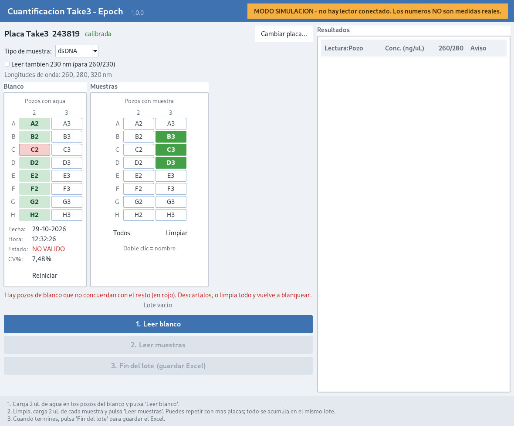

# epoch-open

Free replacement software for a BioTek Epoch microplate spectrophotometer with a Take3
micro-volume plate, for RNA/DNA quantification.

The lab owns the instrument. The vendor software's licence activations are exhausted, so
the instrument was unusable. This project writes a new program that talks to the reader directly. 

It does not modify, patch, bypass or inspect the vendor software, and nothing here depends on it at runtime.

## Who uses this

The daily user is a lab technician who is not a computer person. That constrains the
design more than anything technical does:

- Ships as a **single `.exe`** on Windows. Double-click. No Python, no install, no
  console window, no config files to edit.
- Main screen is a **Take3 plate layout**. Click to mark loaded spots, copying the
  Gen5 picker already known.
- Three buttons: **Read blank**, **Read samples**, **Save results**.
- Results export to **xlsx**, the same format Gen5 produces, so everything done with
  the file afterwards is unchanged.
- Sample type (dsDNA / ssDNA / RNA) is a dropdown, defaulted to whatever the lab uses most.
- Problems are reported in plain language next to the affected well, never as an error
  code or a traceback.

## Status

| Piece | State |
|---|---|
| Quantification math (`epoch_open/quant.py`) | Done, reproduces this lab's Gen5 numbers |
| xlsx export (`epoch_open/xlsx.py`) | Done, no dependencies, verified opens in LibreOffice |
| Take3 layout (`epoch_open/take3.py`) | Done, confirmed from the factory sheet (A2-H3) |
| Reader interface + simulator (`epoch_open/reader.py`) | Done |
| Technician GUI (`epoch_open/gui.py`) | Working against the real instrument |
| Blank validation | Done -- per-well verdict, CV%, discard and reset |
| Test suite | 250 tests passing |
| Protocol capture procedure (`docs/CAPTURE.md`) | No longer needed |
| Serial protocol decode | **Done** — reads confirmed on the instrument |
| USB transport | **Solved** — reader is FTDI virtual COM, pyserial talks to it (`docs/FINDINGS.md`) |
| Instrument driver | Connect, carriage, capabilities, batched multi-wavelength reads |
| Validated against Gen5 | **Yes** — 0.5% on neat ladder, same drops (`docs/VALIDATION.md`) |
| Windows .exe | **Built and working** on the lab laptop: simulation fallback, reader detection, read, export |
| Excel compatibility | Verified — exports open in Excel without a repair prompt |

The software is finished and working end to end on the lab laptop. What remains is not
engineering: let the technician use it, and measure blank drift over a long session
(see the open questions at the end of `docs/VALIDATION.md`).

## The approach

1. **Capture** the serial conversation between Gen5 and the reader during one real Take3
   read, while the Gen5 trial still runs. See `docs/CAPTURE.md`. **Time-critical.**
2. **Decode** the captured bytes into a command set: move carriage, select wavelength,
   read, return values. [PyLabRobot](https://github.com/PyLabRobot/pylabrobot) already has
   a `BioTekPlateReaderBackend` whose version/serial/door commands reportedly work on an
   original Epoch; its read commands do not, apparently because the command set varies by
   firmware. The capture closes exactly that gap, and the result is worth contributing
   back upstream.
3. **Driver** — a small Python module over the reader's USB virtual COM port. The
   original disks confirm the Epoch is an FTDI USB-to-serial device, so this is
   plain pyserial over a COM port; see `docs/FINDINGS.md`.
4. **GUI** — Tkinter, bundled with PyInstaller into one `.exe`.
5. **Validate** — run the same plate through the captured Gen5 reference numbers and this
   software, and confirm they agree well by well before it is used for real samples.

## Quantification

Recovered from this lab's own Gen5 exports and verified against them: subtract the
320 nm reference from each measurement wavelength, subtract the per-well blank, scale
from the 0.5 mm Take3 path to 1 cm, multiply by the extinction factor. For dsDNA that
reduces to `ng/uL = A260 x 1000`.

The derivation, and two assumptions this project got wrong before the real exports
arrived, are in `docs/QUANTIFICATION.md`.

## Using it with a different instrument

Nothing is compiled in: copy `epoch_open.example.json` to
`epoch_open.json` beside the program and edit it. See `docs/FOR_OTHER_LABS.md`.
The one setting that genuinely matters is the pathlength table from your own
Take3's data sheet.

## What it needs

| | |
|---|---|
| Python | 3.10 or newer (it uses `X \| None` annotations). Run here on 3.13 |
| `pyserial` | the only third-party library, and only to talk to the instrument |
| tkinter | for the window. Bundled with Python on Windows and macOS; a separate package on Linux |
| `pyinstaller` | only to build the Windows `.exe` or the macOS `.app` |

Everything else — the Excel writer, the config file, the test runner — is written
against the standard library on purpose, so there is as little as possible to
break or to reinstall in five years.

Reading a plate also needs the **FTDI VCP driver** on Windows. Linux needs nothing:
`ftdi_sio` is in the kernel.

## Installing

### Windows (what the lab actually uses)

1. **Python** from <https://www.python.org/downloads/>, ticking
   **"Add python.exe to PATH"** during setup. Do not use the Microsoft Store
   build: it has shipped without tkinter, and the window will not open.
2. **FTDI VCP driver** from <https://ftdichip.com/drivers/vcp-drivers/>, installed
   **before** the reader is plugged in. The disks that came with the Epoch have
   `USB driver/CDM20600.exe`, which works but dates from 2009.
3. **The source**: on GitHub use *Code -> Download ZIP*, and unpack it somewhere
   stable such as `C:\EpochTake3\` — not Downloads, where it will be tidied away.
4. **Build**: double-click `build_windows.bat`. It checks Python and tkinter,
   installs `pyserial` and `pyinstaller`, and leaves `dist\EpochTake3.exe`.

The exe is self-contained: the technician needs no Python and no console. Put it
somewhere stable and make a Desktop shortcut. `docs/WINDOWS.md` has the checks to
run before handing it to anyone.

### Linux

    sudo apt install python3-tk python3-serial      # Debian/Ubuntu
    sudo usermod -aG dialout $USER                  # then log out and back in

The `dialout` group is what grants access to the serial port. Without it the
program will find the reader and still be unable to open it.

### macOS

Install Python from <https://www.python.org/downloads/> rather than using the
`python3` that ships with macOS, which has come with a Tk too old to draw this
correctly. Homebrew's Python does not include Tk at all — it is packaged
separately as `brew install python-tk@3.13` (matching your minor version), and
without it the program stops with `ModuleNotFoundError: _tkinter`. Then:

    pip3 install pyserial
    python3 run_gui.py

`bash build_macos.sh` produces `dist/EpochTake3.app`. PyInstaller cannot
cross-compile, so that has to run on a Mac. The result is unsigned, so the first
launch is refused with "cannot be opened because the developer cannot be
verified" — right-click the app, choose Open, then Open again, which is
remembered. Signing it properly needs an Apple Developer ID.

No driver is needed: the FTDI driver has been part of macOS since 10.9, and the
reader is found by its USB serial number rather than by any device path, so
`/dev/cu.usbserial-*` works without changes.

The interface has been run on macOS and draws correctly: sharp on a Retina
screen, the layout tightening by itself for the shorter usable height
(`docs/img/gui-macos.png`). What has **not** been tried is a Mac talking to an
actual Epoch, and `build_macos.sh` has never been run, so the `.app` route is
still unverified.

## Blanking

The blank is its own step with its own verdict, the way the technician works at
the bench: mark the water spots, read them, look at the grid, and only then
quantify.

Each blank well shows one of four things:

| | |
|---|---|
| white | not part of the blank |
| **blue** | marked, not read yet |
| **green** | read, and it agrees with the others |
| **red** | read, and it does not agree -- this is the spot to wipe |

Beside the grid are the four fields Gen5 prints: date, time, `VALIDO` /
`NO VALIDO`, and the CV%. **Samples cannot be read while the blank is not
valid** -- the button is disabled rather than failing afterwards.

There are two ways out of a bad blank, and the line under the grids says which
one applies:

- **One well is red.** Click it to discard it. The blank is recomputed from the
  rest without re-reading anything, and clicking again puts it back.
- **Nothing is red but the wells still disagree.** No single well can be blamed,
  so there is nothing to discard: wipe the plate and blank again. `Reiniciar`
  throws away the readings *and* the marks, which is what Gen5 calls Reset
  Blanks.

Marking a new well after a read suspends the blank until it is read too: half a
blank, part measured and part not, must never be subtracted from anybody's
samples.

### Where the two limits come from

A blank fails if any single well sits more than **0.003 AU** from the median of
the others, or if the wells together span more than **0.004 AU**. Both are
measured after the 320 nm correction, because what gets subtracted from every
sample is the difference, not the raw reading.

**These two numbers are this project's own, not Gen5's.** Gen5 shows a verdict
but never says what it tests, and we have no export of a blanking run it
rejected, so there was nothing to reverse-engineer. They are set from the one
run we know Gen5 *passed* -- the eight wells of `Gen5_LVA_NAQ_0001`, which span
0.002 AU with the worst well 0.0015 AU from the median -- so a blank that good
keeps about twice the room it actually needed. Both are in `epoch_open.json`:

    "blank_spread_limit_au": 0.004,
    "blank_divergence_limit_au": 0.003

A lab that finds them too strict or too slack can move them without a rebuild.
If they ever turn out to redden wells on blanks that are genuinely fine, that is
the file to edit, and worth telling us about.

The CV% is computed the way Gen5 reports it, on the raw absorbances per
wavelength, because that is the number the technician is used to reading. It is
*not* what the program gates on -- the spread above is -- and it will not match
Gen5 to the last digit: the exported absorbances are rounded to three decimals,
which on a ~0.045 blank moves a recomputed CV by more than the gap between the
two standard-deviation conventions, so the file cannot even say which one Gen5
used. Expect agreement to a few tenths of a percentage point.

## Running it today

    python3 run_gui.py

**Without an instrument it will not produce numbers.** The window opens, the plate
can be laid out and a saved file can be reopened, but the read buttons are greyed
out and an amber badge says to switch the reader on. It used to fall back to a
built-in simulator, which meant an Epoch that was merely switched off gave a screen
full of invented values behind a warning banner — one misread banner away from
simulated figures in a lab notebook.

The simulator is still there for development and for reviewing the screen without
hardware, but it has to be asked for, and anything it produces is labelled
simulated on screen and inside any file it saves:

    python3 run_gui.py --sim

The order you switch things on does not matter. If the reader is not there at
startup the program keeps looking for it every few seconds, turns the badge green
by itself once it answers and enables the read buttons, so there is no need to
restart it. If the reader stops answering mid-session the badge says so and
reading is disabled again, rather than quietly reverting to simulated numbers.

## Running the tests

    python3 tests/run_tests.py     # no dependencies
    python3 -m pytest tests/ -q    # if pytest is installed

## Layout

    epoch_open/quant.py    quantification, pathlength correction, purity ratios
    tests/                 test suite and a dependency-free runner
    docs/CAPTURE.md        how to capture the protocol from the running Gen5
    docs/FINDINGS.md       what the original instrument disks established
    captures/             (empty) .pcapng files and Gen5 reference numbers go here
