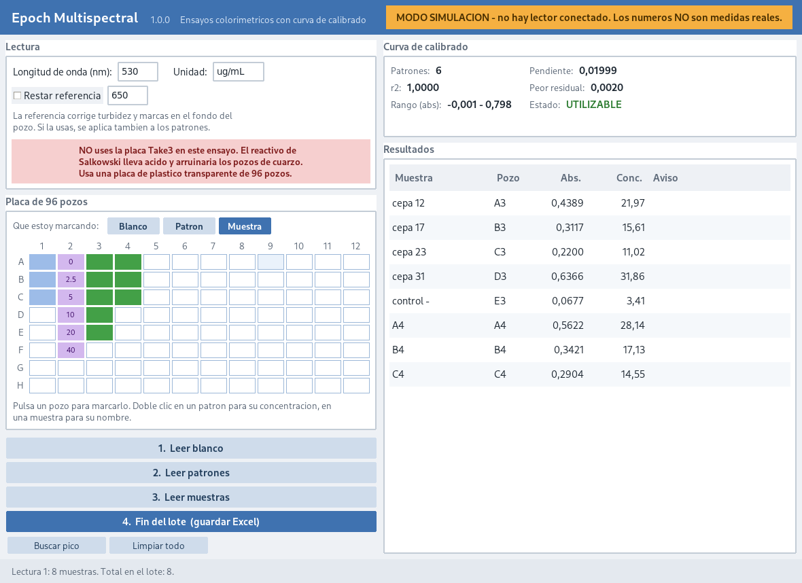

# epoch-multispectral

Colorimetric assays on the Epoch, read against a standard curve measured in
the same run. Written for the Salkowski assay for indole-3-acetic acid at
530 nm; nothing on the screen is specific to it.

*Simulated run: reagent blanks in column 1, a 0-40 ug/mL standard series in
column 2 with each well showing its concentration, samples in columns 3-4.
The amber badge is the simulator saying so.*

**Status: the read path is verified against the instrument (3 November 2026).
The assay is not.**

The program drives the reader, addresses a flat 96-well plate correctly, and
agrees with Gen5 on the same plate to the last digit Gen5 prints. What has
*not* happened is a real assay: no standard curve has been measured on real
reagents, so `curve.py` has still only ever seen numbers this project made up.

### What was verified

**Agreement with Gen5.** An empty plate read minutes apart by both programs at
560 nm: 85 of 96 wells identical to three decimals, largest disagreement
0.0010 AU, mean signed difference -0.00005. See `docs/GEN5_NOTES.md`.

**Addressing.** An empty plate cannot prove the beam lands on the right
wells -- uniform readings look perfect whatever the geometry does. So a
deliberately asymmetric pattern was loaded: diluted coffee down column 1 and
along row H to H10, allulose sweetener in H11 and H12, everything else dry.

| | 530 nm |
|---|---|
| 17 coffee wells | 0.1715 - 0.1859, mean 0.1787 |
| 77 dry wells | 0.0455 - 0.0497, mean 0.0474 |
| separation | **+0.1218 AU** between the weakest loaded and strongest dry well |

Every loaded well read higher than every dry one, with no overlap, and the
set of wells reading high was **exactly** the set that had been pipetted --
none missing, none spurious. The geometry addresses a flat 96-well plate
correctly.

### Two things that fell out of it

**Something colourless in a well still changes the reading.** The allulose
wells came back at 0.0395 and 0.0390 against 0.0474 for the dry wells --
about 0.008 AU *below* empty, and flat across 530/560/590, as a non-absorbing
solution should be.

Read carefully, because this is weaker evidence than it first looks. Those
were a few unmeasured drops, not a filled well, so what it shows is that
*some* liquid reads below *no* liquid. It says nothing about how the reading
varies with volume, because a properly filled well was never read for
comparison. In particular it does not establish which way a partly filled
well errs.

What survives is the direction and the reason: filling a well changes its
optics whether or not the contents absorb. That is enough to justify the
ordinary discipline of **keeping every well at the same volume, blanks
included**, and enough to say that an empty or badly under-filled well will
not read as a neutral zero. How large that error is at assay volumes is
unmeasured, and would take one plate of water at 50, 100, 150 and 200 uL to
settle if it ever mattered.

It is also why water is a poor choice for this test. Water against air would
have given roughly 0.008 AU in a counterintuitive direction; the coffee gave
0.12 AU in the obvious one.

**The coffee spectrum is physically sensible.** 0.179 at 530, 0.150 at 560,
0.131 at 590 -- a smooth decline towards the red, which is what a brown
solution should do, and a weak confirmation that the three wavelengths are
really the three wavelengths.

## Do not use the Take3 plate

Salkowski reagent is ferric chloride in perchloric or sulfuric acid. It would
ruin the quartz micro-spots the Take3 depends on, the residue would poison
every nucleic-acid reading afterwards, and the plate holds 2 µL where this
assay needs ~200. Use a disposable flat-bottom transparent 96-well plate.

At 530 nm this costs nothing: polystyrene is transparent through the visible,
so the UV limitation that forces quartz at 260/280 nm does not apply here.

## Why a curve instead of physics

The Take3 program computes concentration from Beer-Lambert: a known extinction
coefficient and the measured thickness of the drop. A colorimetric assay has
no such constant. The coloured product's extinction coefficient depends on the
reagent batch, the acid, the temperature and how long the colour developed, so
nobody tabulates it. You measure known concentrations beside the unknowns and
read the unknowns off the line.

Two consequences:

**Pathlength drops out.** It is identical for every well in a flat plate
filled to the same volume, so it scales standards and samples alike and
cancels. There is no data sheet to copy and no per-well table — but every well
really does have to hold the same volume, and that is pipetting discipline,
not something the software can check.

**The curve itself can be wrong,** and a wrong curve is quiet: a mis-diluted
standard or a transcription slip produces a confident-looking line and
silently wrong answers for everything read against it. So the fit is reported
with its slope, intercept, r², worst residual and measurable range, on screen
and in the workbook, rather than as a pass mark.

## It is a spectrophotometer first

The blank and the standards are optional. Mark wells as samples, press
**Leer muestras**, and you get absorbances -- no blank, no standards, no
curve. That is what the instrument does, and what Gen5 offers before any
data reduction is configured.

This program used to refuse. A sample could not be read until a usable curve
existed, which made taking a measurement conditional on having an
interpretation for it. Gabo put the distinction plainly: the Take3 side
genuinely needs a blank, because a nucleic-acid concentration is
Beer-Lambert applied to a blank-corrected absorbance and there is nothing to
report without one -- but this module should work as a spectrophotometer,
which reads.

What is still guaranteed is narrower and is the part worth keeping: **a
concentration is never reported from a curve that cannot support it.** With
no curve, or a curve that fails its checks, the concentration comes back
empty rather than as a number with a warning beside it. The table shows a
dash; the workbook leaves the cell blank and records "ninguna: lectura
directa en absorbancia", so a raw read can never be mistaken later for a
quantified one. A run without a curve exports two sheets instead of three,
because a Curva sheet describing nothing is worse than no Curva sheet.

Adding standards upgrades the answer rather than unlocking it.

## The four steps

Marked wells take a role — blank, standard or sample — chosen with the three
buttons above the plate. One hue per role, pale while marked and unmeasured,
stronger once measured:

| | |
|---|---|
| white | not in use |
| **blue** | reagent blank |
| **violet** | standard; the well shows its concentration, or `?` if not set yet |
| **green** | sample |
| **red** | a standard sitting further off the line than the others |

Double-click a standard for its concentration, a sample for its name.

1. **Leer blanco** — reagent blank. Its mean absorbance is subtracted from
   everything, standards included.
2. **Leer patrones** — fits the curve. At least three standards, each with a
   concentration; the button stays disabled until that is true.
3. **Leer muestras** — only once the curve is usable.
4. **Fin del lote** — writes the workbook and clears the batch.

**Buscar pico** is separate and optional: it reads nine wavelengths across the
visible in one pass and says where the colour actually absorbed most. Published
Salkowski protocols range over 530–540 nm and the true peak moves with the
reagent formulation, so this is worth one read per reagent batch rather than
inheriting a number from a paper. Nine because the reader takes at most nine
wavelengths per pass — the count field in the `D` assay record holds one digit.

## What it refuses

- **Fewer than three standards.** Two points fit a line with r² exactly 1
  whatever they are, which would report a perfect curve for no reason.
- **Standards all at one concentration.** No line exists.
- **A curve that falls as concentration rises,** or is flat. More colour must
  absorb more; a descending curve means swapped standards, the wrong
  wavelength, or reagent that did not react. Nothing is read off it.
- **Samples, until the curve is usable.** The button is disabled rather than
  accepting the press and explaining afterwards.
- **A standard with no concentration entered.** It would otherwise drop out of
  the fit silently.

A poor r² is *not* a refusal — it is noted and the curve stays usable, because
a curve good enough for a rough answer should not produce nothing. The
technician sees the number and decides.

## What it throws away

A curve is only valid for the plate it was measured on, so it is discarded
when that stops being true: when a well's role changes, when the blank is
re-read, or when the reference wavelength is switched on or off. In each case
leaving the fit in place would let samples be quantified against standards
that no longer apply, which is exactly the quiet kind of wrong this program
exists to prevent.

## The optional reference

A second wavelength, default 650 nm, subtracted from the measurement the way
320 nm is on the Take3 side. In the visible it corrects for turbidity and for
marks on the plate bottom, which affect both wavelengths about equally while
the coloured product absorbs at only one.

**Off by default,** because the standard protocol does not use it and
switching it on changes the numbers. It is applied to the standards as well,
which is why toggling it discards the fit.

Turbidity is better removed than corrected: read centrifuged or filtered
cell-free supernatant. Scatter raises absorbance with no colour involved.

## Known blind spot

A **saturating curve passes every automatic check.** A series whose absorbance
steps shrink as concentration rises — a colorimetric assay running out of
reagent at the top, the most likely real failure here — still fits a straight
line with r² ≈ 0.99, clears the 0.98 gate, and produces no warnings. The top
of the range is nonetheless wrong, and a high sample read against that line is
under-reported.

No threshold in `curve.py` catches it. The worst residual does not either: in
the case pinned in `tests/test_curve.py` it sits about 4% of the span off the
line, inside `RESIDUAL_LIMIT`. That is why `worst_residual` is displayed and
exported as a number rather than as a verdict — a person looking at the
standards can see a bend that no single statistic here reports.

The real remedy is experimental: keep the top standard below saturation. The
`above_range` warning pushes samples towards that by refusing to report
anything above the top standard as a plain number.

## Thresholds, and where they come from

In `epoch_open/curve.py`, and they are conventions rather than measurements
from this lab:

    MIN_STANDARDS   = 3       below this no curve is fitted at all
    THIN_STANDARDS  = 4       below this the curve is fitted but noted
    R_SQUARED_MIN   = 0.98    the usual figure asked of a working curve
    RESIDUAL_LIMIT  = 0.10    one standard this far off the span is named

0.98 is what a working standard curve is normally expected to clear and 0.99
what a good one does. Unlike the Take3 blanking limits — see
`docs/BLANK_THRESHOLD.md`, where there was a Gen5 verdict to calibrate against —
there is no vendor behaviour to recover here, because Gen5's licence never
reached this assay in this lab. These are ordinary analytical-chemistry
conventions, and the code says so.

## The workbook

Three sheets, because a concentration from a curve is unauditable without the
curve:

- **Resumen** — one row per sample: name, well, absorbance, concentration,
  whether it was in range, and any warning.
- **Curva** — every standard with its residual, then slope, intercept, r²,
  worst residual, measurable absorbance range, and every misgiving the fit
  recorded in full. Not a pass mark: a reader six months later needs to know
  what the curve was accepted *in spite of*.
- **Detalle** — every well read, raw, nothing subtracted, so the plate can be
  reconstructed without trusting any arithmetic above it.

## Simulator

    python3 run_multispectral.py --sim

`MockCurveReader` is told what it is pretending to hold, unlike the Take3
simulator which gives every well an independent random signal. That is
deliberate: a simulator that randomised the standards would make the program
look broken — every curve rejected — when it was working. Standards get the
concentrations typed in, so the fake curve is a real line through them;
samples get a plausible spread, and the absorption band is a Gaussian centred
on 530 nm, which is what makes **Buscar pico** demonstrable without reagents.

The consequence, pinned in `tests/test_gui_multispectral.py`: the simulator
cannot produce a mis-pipetted standard, so the red-outlier path is tested by
installing a fit directly. That case is only reachable with hardware.

## First real run

The instrument side is done; what follows is the assay side, which is still
entirely unverified:

1. `python3 run_multispectral.py` and check the badge goes green with serial
   254717.
2. Water in every well of a flat plate, read as blanks at 530 nm. All eight
   should agree closely; a spread means the plate, not the program.
3. An IAA standard series in the same plate, read as standards. Check the
   slope is positive, r² > 0.99, and the concentrations on the wells match
   what was pipetted.
4. **Buscar pico** on the most concentrated standard, and compare with 530 nm.
5. One known sample read as an unknown, and check it comes back near its
   expected value.
6. Save, and open the workbook in Excel.

Step 2 is the one that matters most: it is the only step whose correct answer
is known in advance.
